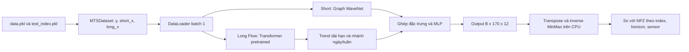

# Kiểm chứng B và C1 — baseline LSTTN PEMS08

Ngày kiểm tra: 20/11/2026. Đây là hồ sơ kỹ thuật kiểm chứng, không phải báo cáo môn học hoàn chỉnh.

## 1. Kết luận và phạm vi

**B: đã kiểm tra và ghi nhận pipeline; còn hạn chế về nguồn preprocessing và lịch thực. C1: PARTIAL, phép đối chiếu prediction có trạng thái FAIL ở tolerance đã chọn.** Checkpoint epoch 68 load strict thành công; đã inference 4 cửa sổ thật trên RTX 3050 Laptop 6 GB, batch 1. Shape đúng, mọi giá trị hữu hạn, không OOM/CUDA error. Target và mask khớp tuyệt đối export. Có 5/8.160 prediction vượt tolerance; không nới ngưỡng, không gọi đây là PASS.

Không huấn luyện, backward hoặc optimizer.step; không chạy inference toàn bộ test; không thay đổi model, dataset, checkpoint hoặc export. Các hash file được đọc trong smoke test không thay đổi trước/sau. Script và tài liệu mới chỉ nằm trong thư mục này. Lần chạy chẩn đoán được lưu riêng, không ghi đè lần đầu.

## 2. Thành phần đã đọc và pipeline

Các đường dẫn dưới đây tính từ gốc repository:

| Thành phần | Nguồn kiểm tra |
|---|---|
| Dataset thực tế | `utils/datasets.py`, `datasets/PEMS08/data.pkl`, ba file `*_index.pkl` |
| Config baseline | `configs/PEMS08/forecasting.py`, `configs/actual/PEMS08.py` |
| Runner và DataLoader | `runners/lsttn.py`: dùng MTSDataset; loader của EasyTorch; train shuffle sau khi chọn tập, val/test không shuffle |
| Chuẩn hóa và đồ thị | `utils/load_data.py`, `utils/adj_mx.py`, `datasets/PEMS08/min.pkl`, `max.pkl`, `datasets/sensor_graph/adj_mx_08.pkl` |
| Model | `models/lsttn.py`, `models/transformer.py`, `models/graph_wavenet.py` |
| Pretrained | `pretrained_transformers/PEMS08.pt` |
| Forecasting checkpoint | Đường dẫn đầy đủ trong `smoke_results.json`, lấy từ `results/extension/inference_cost.json`; tên `LSTTN_best_val_loss.pt` |
| Export | `utils/prediction_export.py`, `artifacts/report-inputs/PEMS08/batch_*.npz` và metadata |
| Dữ liệu thô đối chứng | `datasets/PEMS08/raw/pems08.npz` |

Smoke test dùng đúng lớp Dataset và model hiện tại, tái hiện đường evaluation của runner; không khởi tạo runner huấn luyện. `utils/load_data.py:load_dataset` là helper khác, không phải bằng chứng runner dùng helper này.

## 3. Dữ liệu và shape thực tế

Dữ liệu đã xử lý có shape **[17856,170,3]**. Mỗi index là `[a,b,c]`: short lấy `[a,b)`, target lấy `[b,c)`, long lấy `[b-4032,b)`.

| Tensor | Shape, với batch B | Nội dung |
|---|---|---|
| short_x | [B,12,170,3] | 60 phút gần nhất |
| long_x | [B,4032,170,3] | 14 ngày trước thời điểm dự báo |
| y | [B,12,170,3] | Dataset trả cả ba kênh; target dự báo chỉ kênh 0 |
| Output model | [B,170,12] | Flow chuẩn hóa |
| Prediction so sánh | [B,12,170] | Flow sau inverse, giống trục export |

Dữ liệu thô được mô tả là Flow/Occupancy/Speed. **Không được dùng mô tả đó cho ba kênh input đã xử lý**: kênh 0 là Flow chuẩn hóa; kênh 1 là `(timestamp_index % 288)/288`; kênh 2 là `(timestamp_index // 288)%7`. Hai kênh lịch đã được kiểm tra trực tiếp với toàn bộ tensor. Graph WaveNet cắt `input[:,:2]`, dùng Flow và time-of-day. Transformer chỉ lấy Flow. Thứ tự cảm biến không bị sắp xếp lại trong Dataset hoặc phép so sánh; so sánh đủ 170 vị trí, không gán thêm ID vật lý chưa được xác minh.

Các mẫu huấn luyện quá sớm, chưa có 4032 bước lịch sử, nhận **toàn bộ long_x bằng 0**, không phải giữ phần có sẵn rồi chỉ pad phần thiếu. Bốn mẫu test đều đủ lịch sử.

## 4. Split, normalization và leakage

| Tập | Số cửa sổ | Index đầu | Index cuối |
|---|---:|---|---|
| Train | 10700 | [0,12,24] | [10699,10711,10723] |
| Validation | 3567 | [10700,10712,10724] | [14266,14278,14290] |
| Test | 3566 | [14267,14279,14291] | [17832,17844,17856] |

Tổng 17.833 cửa sổ, xấp xỉ **60%/20%/20%, không phải 70%/20%/10%**. Các index tăng liên tiếp theo thời gian. Hình dạng index chứng minh các cửa sổ trên toàn chuỗi được phân thành các đoạn liên tiếp, không phải chia thành ba chuỗi timestamp độc lập rồi mới window từng chuỗi. Chưa có đầy đủ nguồn sinh pickle gốc để xác nhận lịch sử thao tác preprocessing; đây là kết luận từ artifact đang được Dataset đọc.

Có **11 timestamp nhãn chồng train/val**, **11 chồng val/test**, không có nhãn chồng train/test. Đây là vấn đề độc lập giữa các tập, không chỉ là input overlap. Input lịch sử có thể nằm ở tập trước và là quan sát hợp lệ tại thời điểm dự báo; bản thân điều này không chứng minh leakage. Trong từng cửa sổ, input dừng trước b, target bắt đầu tại b. Chồng nhãn val/test vẫn ảnh hưởng tính độc lập khi lựa chọn checkpoint theo validation.

Baseline dùng **MinMax**, không dùng StandardScaler:

`flow_original = (flow_normalized + 1) / 2 * (1077 - 0) + 0`.

Kiểm tra mới trên raw: min/max đoạn train đến hết nhãn cuối là **0/1077**; min/max toàn dữ liệu là **0/1147**. Scaler lưu 0/1077 phù hợp train, khác toàn dữ liệu. Đây là bằng chứng không lấy max toàn chuỗi, nhưng chưa đủ truy ngược chính xác mọi dòng code fit ban đầu. Inverse tensor float32 so raw Flow có sai khác lớn nhất 0,0001220703125, phù hợp làm tròn số học. Không clip các giá trị ngoài [-1,1].

Không sửa split PEMS08 trong nhiệm vụ này vì cần giữ nguyên giao thức checkpoint/export. Nếu chuyển sang 7:2:1 hoặc loại nhãn chồng, phải tạo dữ liệu riêng và không mang metric cũ sang giao thức mới.

## 5. Nguồn lịch sử ngày/tuần

Transformer nhận [B,170,1,4032], patch 12 bước thành 336 token. Nhánh tuần lấy token `-169`, nhánh ngày lấy `-25`. Với forecast origin b, patch gốc tương ứng tuần là `[b-2028,b-2016)`, ngày là `[b-300,b-288)`: giờ ngay trước mốc tương ứng một tuần/một ngày trước. Các token sau Transformer đã được contextualize bằng toàn bộ long input, không phải chỉ đại diện độc lập cho patch đó. Toàn bộ long input vẫn nằm trước thời điểm dự báo.

Kênh ngày là ngày tương đối tính từ index 0, chưa tự chứng minh ngày lịch tuyệt đối. E1/E2 dùng giả định bắt đầu 01/07/2016; cần chứng từ timestamp nguồn để xác minh việc gán thứ/ngày thường/cuối tuần.

## 6. E1/E2/E3: bằng chứng và khả năng sử dụng

VERIFIED dưới đây nghĩa là có code và hồ sơ kết quả chạy số học thực tế; không có nghĩa mọi yêu cầu khoa học đã được giải quyết. Đợt này không chạy lại toàn bộ E1/E2 và không thay thế kết quả cũ.

| Thực nghiệm | Trạng thái | Input → output và thay đổi | Bằng chứng | Hạn chế, dùng báo cáo |
|---|---|---|---|---|
| E1 Persistence/HA | VERIFIED trong giao thức baseline cũ | Index test và Flow; Persistence lặp giá trị cuối, HA lấy trung bình nhóm weekday/slot từ train; xuất MAE/RMSE/MAPE so LSTTN. Không thay trọng số LSTTN | `scripts/extension/run_baselines_pems08.py`, `results/extension/baselines_pems08.csv`, `baselines_pems08_protocol.json`: success, index/target/mask exact, kiểm tra metric và perturb ngoài train | HA dùng 10.711 timestamp nhãn train duy nhất, không dùng timestamp riêng val/test; 11 timestamp thuộc cả train và val. Có thể dùng làm đối chứng cùng split cũ, không gọi là giao thức nhãn độc lập |
| E2 Phân tích sai số | PARTIAL về diễn giải lịch; số liệu đã có kiểm chứng | Export cũ → bảng node/giờ/day-type/quantile và hình; không chạy lại model | `scripts/extension/analyze_pems08_errors.py`, `results/extension/error_analysis/protocol.json`, `node_metrics.csv`, `hourly_metrics.csv`, `day_type_metrics.csv`, `flow_quantile_metrics.csv`, `overall_metrics_verified.csv`; gate metric pass atol 1e-8 | Có thể dùng phân tích node/mức Flow; giờ phụ thuộc mốc ngày. Không khẳng định kết luận ngày thường/cuối tuần trước khi xác nhận lịch. Quantile tính trên test là mô tả hậu nghiệm, không dùng chọn model |
| E3 Đồ thị | VERIFIED cho phép toán và kiểm tra cấu trúc | Tensor toy + adjacency thật → output, tổng hàng và kết luận đại số; không thay baseline | `scripts/extension/verify_graph_conv.py`, `results/extension/graph_conv_check.json`; đợt này chạy lại toy trên lớp thật, ghi trong JSON smoke | Chứng minh einsum author không trộn node trong riêng phép toán đó. Không chứng minh mô hình sửa sẽ tăng accuracy; chưa thay thế ablation/huấn luyện đối chứng |

E3: `einsum('bnh,nm->bnh') = x[b,n,h] * sum_m A[n,m]`. Nếu tổng hàng bằng 1 thì riêng phép này là identity; không phải toàn module identity vì còn Linear, concatenation, dropout. Toy x=[1,10], ma trận hoán đổi cho output author=[1,10], trong khi tổng hợp láng giềng cho [10,1]. Không suy rộng lỗi đó sang Graph WaveNet, vốn dùng phép nconv khác. Đối chiếu phương trình (3.2) cần hiểu quy ước hàng/cột của ma trận; kết quả kiểm tra không tự xác nhận toàn bộ nội dung phương trình trong báo cáo PDF.

Để minh họa kết quả đã lưu: MAE 15/30/60 phút của Persistence là 19,5284/24,1937/34,5923; HA 23,2743/23,2608/23,2321; LSTTN 13,3996/14,1934/15,3880. Đây là kết quả baseline cũ và hồ sơ E1/E2, không phải metric mới tính từ bốn mẫu smoke và không phải số liệu paper.

## 7. Checkpoint và smoke test mới

Môi trường thực chạy: Windows, Python 3.9.13, torch 1.8.1+cu111, CUDA build 11.1, cuDNN 8005, NumPy 1.26.4, RTX 3050 Laptop 6 GB. Các dependency cần để import Dataset/config/model và inference hoạt động; không nâng cấp môi trường. Không kiểm thử mọi dependency của toàn dự án.

- Forecast checkpoint epoch **68**, strict load không thiếu/thừa key. SHA-256: `d3b8b3fa9f988c5018266e84f24397c24a60311024c08ad7f7bd531020bab55d`.
- Pretrained SHA-256: `4b7efb021ce4b432347f46f4197ab8dbab9f01c7e0a0265f81a764cb1633a73e`. Mọi tensor state của Transformer pretrained khớp phần Transformer trong forecasting checkpoint. Đây mạnh hơn việc chỉ đối chiếu hash tên file.
- Chế độ `full`, `legacy`, graph `author`, transformer policy `baseline`; model.eval cho mọi module, no_grad, không AMP/cache, TF32 tắt. Batch 1.
- Export dtype float32; inverse bằng đúng `max_min_scale` trên CPU như export pipeline. Target/mask khớp tuyệt đối ở cả bốn mẫu.

Tolerance cố định trước chạy: `abs(new-old) <= 1e-5 + 1e-4*abs(old)`. Đây là ngưỡng khởi đầu cho FP32 và khác biệt kernel/batch; không đảm bảo mọi số gần 0 sẽ đạt.

| Vị trí test (0-based) | Index [a,b,c] | Export / hàng | Max abs | Mean abs | Vượt ngưỡng / 2040 |
|---:|---|---|---:|---:|---:|
| 0 | [14267,14279,14291] | batch_000000 / 0 | 0,0001220703 | 0,0000096377 | 0 |
| 31 | [14298,14310,14322] | batch_000000 / 31 | 0,0001220703 | 0,0000103128 | 0 |
| 32 | [14299,14311,14323] | batch_000001 / 0 | 0,0001220703 | 0,0000103749 | 0 |
| 3565 | [17832,17844,17856] | batch_000111 / 13 | 0,0000991821 | 0,0000145755 | 5 |

Sai khác nhỏ phù hợp khả năng làm tròn FP32 giữa GPU/batch/môi trường, nhưng **chưa cô lập được nguyên nhân**. Sai checkpoint, index, target hoặc quên eval không được bằng chứng hiện tại ủng hộ: checkpoint đúng hash/epoch, Transformer khớp, target exact, mọi module eval. Không được biến giả thuyết làm tròn thành kết luận PASS. Lần chẩn đoán lưu giá trị mới/cũ và tọa độ các phần tử vượt tolerance để kiểm tra tiếp.

Lần chẩn đoán đã chạy xong và lặp lại cùng kết quả: max abs toàn bộ **0,0001220703125**, mean abs **0,00001122524195**, 5/8.160 phần tử vượt ngưỡng. Năm tọa độ (horizon 1-based, sensor position 0-based) là (5,33), (10,147), (10,169), (11,139), (12,139), đều thuộc mẫu 3565. Ví dụ tại (11,139), export = 0,04583466053, prediction mới = 0,04580256343, sai khác = 0,00003209710 trong khi ngưỡng cho phép chỉ 0,00001458347. Ngưỡng tương đối nhỏ gần 0 giải thích vì sao sai khác nhỏ vẫn FAIL; chưa giải thích duy nhất nguồn phát sinh sai khác. Một số prediction âm xuất hiện trong cả export cũ và inference mới; không tự clip về 0 vì sẽ thay đổi baseline.

## 8. Điều kiện dùng baseline tiếp theo

Baseline **chạy được và có thể dùng để phát triển/debug thí nghiệm cùng giao thức cũ**, với giới hạn được nêu rõ. Chưa nên tuyên bố đã vượt kiểm tra tương đương export ở tolerance này, tái hiện đầy đủ paper, hay đánh giá không leakage. Không cần huấn luyện lại chỉ để xử lý sai khác smoke hiện tại. Bước tiếp theo là đối chiếu chính các phần tử thất bại dưới môi trường/kernel/batch của export gốc, giữ nguyên ngưỡng; việc chạy batch lớn phải xét VRAM riêng. Không chạy bước đó tự động trên GPU 6 GB trong đợt này.

Nếu nghiên cứu tiếp bằng split 7:2:1 hoặc nhãn không chồng, cần giao thức và dataset riêng; checkpoint cũ chỉ còn là mô hình đã huấn luyện trên split cũ, không được gán metric cũ cho test mới. Kết luận hiệu năng cải tiến cần các mô hình được đánh giá trên cùng test và quy tắc preprocessing, không dựa vào hash hay bốn mẫu smoke.
